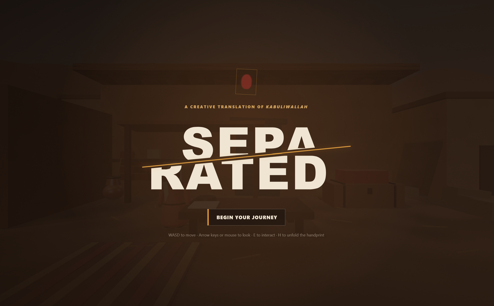

# SEPA/RATED - A Creative Translation of Kabuliwallah



Gameplay:
[https://youtu.be/PihPsuKHgn4](https://youtu.be/PihPsuKHgn4)

## Install

```bash
npm install
npm run dev
```

Open the local URL shown in the terminal.

## Controls

- `WASD`: move
- Arrow keys or mouse: look
- `E` or `Enter`: interact
- `H`: open or close the handprint

## Build and test

```bash
npm run build
npm test
```
